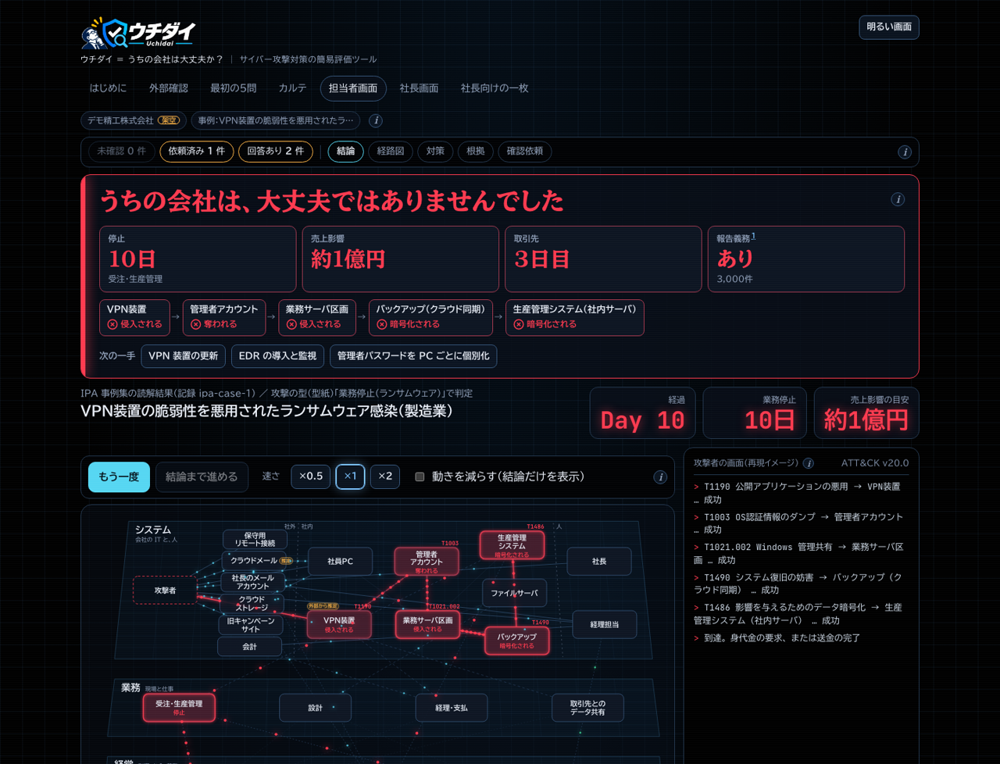
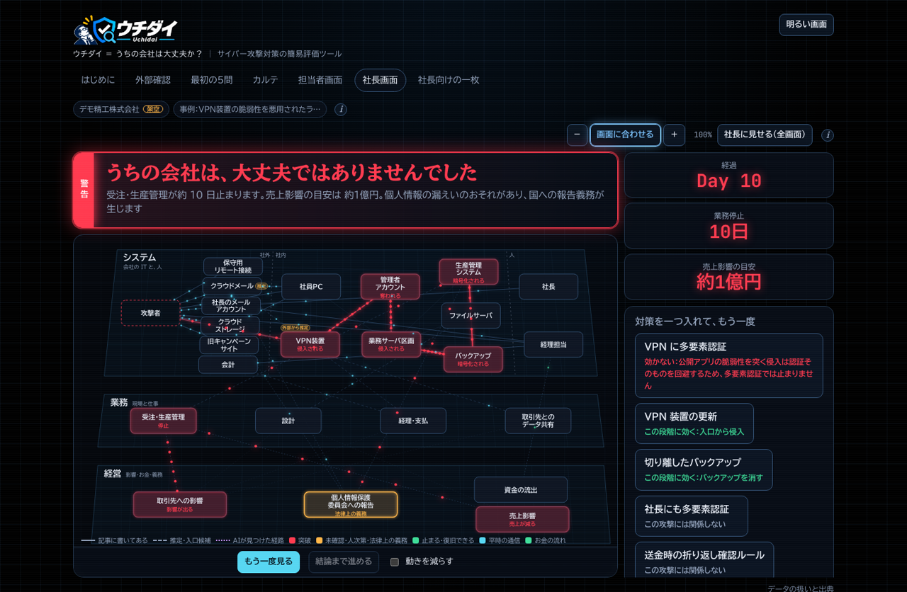
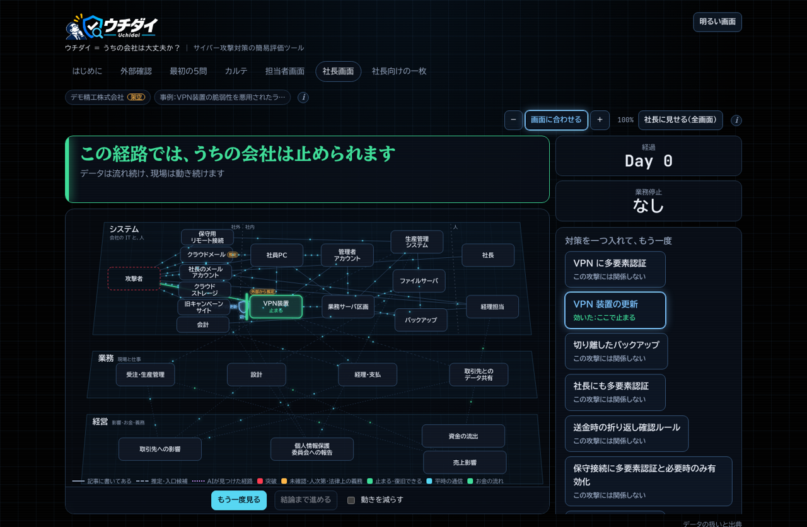
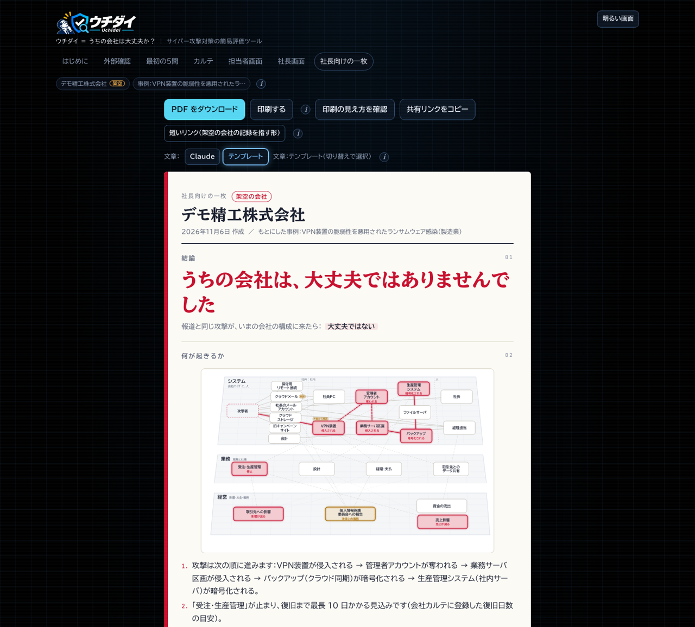

# ウチダイ

**ウチダイ ＝ うちの会社は大丈夫か？｜サイバー攻撃対策の簡易評価ツール。社長の「うちは大丈夫？」に、根拠つきで答える。**

多くの日本企業では、他社のサイバー被害の報道を見た社長から「うちの会社は大丈夫か？」と、情報システム担当者が聞かれることがあります。特にセキュリティの専門家がいない企業では、「大丈夫か？」と唐突に言われても、その場でなんの根拠もなく即答するわけにはいきません。また調査するにしても、サイバーセキュリティに関する知見が高くなければ、ニュースからどのような事態が発生しているのかを把握すること自体に時間がかかるうえに、システム環境の個別の調査や、外部のITベンダーへの確認など、さらに多くの時間を要することが課題です。

そこでウチダイの登場です。ウチダイは、ニュース記事の本文やリンクを貼ると、サイバー攻撃の手法を分析し、社長に対して数分で「結論・根拠・次の一手」を返せるようにする、サイバー攻撃対策の簡易評価ツールです。報道と同じ攻撃が自社の構成の上をどう進むかを図で再生し、「止められます」か「大丈夫ではありませんでした」かのどちらかを示し、現状と対応策について、社長向けの一枚の資料にまとめます。

> **すぐに使う**：[**最新版のポータブル ZIP をダウンロード**](https://github.com/securebase-jp/uchidai/releases/latest)（Windows・Mac・Linux。Node も Docker も要りません）。展開して「ウチダイを起動」を開くだけです。手順は [動かし方](#動かし方) にあります。

<!-- デモ動画（YouTube）のリンクを、公開後にここへ置く -->

## 何ができるか

三つの層を一本の経路でつなぎ、担当者と経営の双方にとって有益となるアウトプットを提供します。

| 層           | 問い                   | 材料                                                        | 誰が決めるか                                        |
| ------------ | ---------------------- | ----------------------------------------------------------- | --------------------------------------------------- |
| 攻撃の型     | 攻撃者は何をするか     | 報道記事、MITRE ATT&CK Enterprise                           | Claude が記事を読み、プログラムが手法 ID を照合する |
| 自社の守り   | その攻撃は自社で通るか | 外部確認（DNS・証明書の公開ログ）、会社カルテ、ベンダー回答 | プログラム（判定ルール表）                          |
| 経営への影響 | 通ったら何が起きるか   | 業務の数値、法令・実務上の期限、費用の目安                  | プログラム（固定データ）                            |

Claude が担当するのは「読む（記事・PDF）、言い換える（社長向け）、書く（確認依頼の文）、探す（AI攻撃者）」だけです。実際に攻撃が発生した際に、それを防ぐことができるか？の判定や、被害発生時に要する日数と想定被害額、期限はすべてプログラムが決定的に計算します。Claude の出力は zod で検証し、存在しない手法 ID や型紙（攻撃手法のテンプレート）にない手法は捨てています。記事の内容で結論を操作することはできません。

画面は三つあります。担当者画面では、攻撃の経路を再生して各段階の根拠を確かめ、対策ボタンを押して判定をやり直せます。ベンダーへの確認依頼と送信箱、AI攻撃者、知見のない AI との比較もここにあります。社長画面は、専門用語を使わずに結論を自動で再生します。社長向けの一枚は、印刷するか共有リンクで渡せるようにしたものです。

## 画面

画面はすべて架空の会社（デモ精工株式会社）と、IPA 事例集の事例 1（VPN 装置の脆弱性を悪用されたランサムウェア）の例です。

**担当者画面**：結論、経路、止まる業務、次の一手を一画面に出します。攻撃が通った順の再生と、各段階の根拠もここで確かめます。



**社長画面**：専門用語を出さず、30〜40 秒の一本の物語として再生します。対策を一つ入れると、判定がその場でやり直されます。下は、対策を入れる前と、VPN 装置の更新を入れたあとです。

| 対策を入れる前                                                                                         | VPN 装置の更新を入れたあと                                                                                 |
| ------------------------------------------------------------------------------------------------------ | ---------------------------------------------------------------------------------------------------------- |
|  |  |

**社長向けの一枚**：専門用語のない A4 の一枚です。結論、何が起きるか、止まる業務と日数、お金への影響、期限、必要な対策を載せます。PDF にも、共有リンクにもできます。



## 動かし方

使う環境に合わせて、次の 3 つから選べます。どれも、手元の PC の中だけで動きます。

### ポータブル ZIP（Node も Docker も不要）

自分の環境の ZIP をダウンロードし、展開して「ウチダイを起動」を開くだけです。最新版は [Releases](https://github.com/securebase-jp/uchidai/releases/latest) にあります。

<!-- リリースのたびに、この表のダウンロードの版（0.1.1）を新しい版に更新する -->

| お使いの環境                   | ダウンロード（v0.1.1、約 70MB）                                                                                                  |
| ------------------------------ | -------------------------------------------------------------------------------------------------------------------------------- |
| Windows 10 / 11（64 ビット）   | [uchidai-0.1.1-win-x64.zip](https://github.com/securebase-jp/uchidai/releases/download/v0.1.1/uchidai-0.1.1-win-x64.zip)         |
| Mac（Apple シリコン：M1 以降） | [uchidai-0.1.1-macos-arm64.zip](https://github.com/securebase-jp/uchidai/releases/download/v0.1.1/uchidai-0.1.1-macos-arm64.zip) |
| Mac（Intel）                   | [uchidai-0.1.1-macos-x64.zip](https://github.com/securebase-jp/uchidai/releases/download/v0.1.1/uchidai-0.1.1-macos-x64.zip)     |
| Linux（x64）                   | [uchidai-0.1.1-linux-x64.zip](https://github.com/securebase-jp/uchidai/releases/download/v0.1.1/uchidai-0.1.1-linux-x64.zip)     |

1. ダウンロードした ZIP を**展開**します（Windows は右クリックの「すべて展開」）。
2. 展開したフォルダの **ウチダイを起動**（Windows は `.bat`、Mac は `.command`、Linux は `./start.sh`）を開きます。
3. 「準備ができました」と出たら、ブラウザで表示された `http://127.0.0.1:…` を開きます。

署名のない配布物なので、Windows と Mac は最初に警告を出します。対処、ダウンロードした ZIP が公開されたものと同じか確かめる方法（`SHA256SUMS`）、データの保存先は、[docs/install-zip.md](docs/install-zip.md) にあります。Mac がどちらか分からないときは、アップルメニューの「このMacについて」の「チップ」を見てください（「Apple M…」なら Apple シリコン、「Intel」なら Intel です）。

### Docker（公開イメージ）

Docker が入っていれば、公開済みのイメージ（`ghcr.io/securebase-jp/uchidai`）を `docker compose up -d` で動かせます。手順は [docs/install.md](docs/install.md) です。http://localhost:8787 を開いてください。

### ソースから（開発者向け）

Node 22.18 以上と pnpm が要ります。

```bash
pnpm install
cp .env.example .env   # ANTHROPIC_API_KEY を自分のキーで埋める（無くても動く。下の「API キーが無くても使える範囲」）
pnpm dev               # 画面 http://localhost:5173 と API（8787）
```

ソースからイメージを作るときは次のとおりです。

```bash
docker build -t uchidai .
docker run --rm -p 127.0.0.1:8787:8787 --env-file .env uchidai
```

`-p 127.0.0.1:8787:8787` で手元だけに公開します（会社カルテを扱う API が外から見えないように）。環境変数の一覧と細かい手順は [docs/usage.md](docs/usage.md) にあります。

## 使い方（5 段）

トップ画面（`#/`）が次の順に案内し、それぞれの段の「いまの状態」も表示します。

### 1. 自社のドメインを外から見る（任意、`#/domain`）

ドメインを入力するとトークンが発行されます。DNS に TXT レコード（名前 `@`、値 `uchidai-verify=<トークン>`）を追加して、自社のドメインであることを確認します。確認できたドメインについてだけ、DNS の公開レコードと証明書の公開ログ（crt.sh。載っていないときだけ Cert Spotter）を参照し、VPN らしいホスト名、SPF・DMARC、メールやホームページの提供元の手がかりを集めます。ホスト名は証明書の公開ログに載っている名前から集めます。そのため、証明書を一度も発行していないホストは見えません（名前の総当たりはしません）。結果は 5 問の初期値（「外部から推定」の印つき）と、カルテの属性や矛盾の指摘に反映されます。**対象のホストには一切アクセスしません。**

### 2. 最初の 5 問に答える（`#/questions`）

業種、現場、仕事の置き場所、社外からのつなぎ方、バックアップについて答えます。すべて選択式で、答えるたびに構成図の枠が組み上がります（「前の質問に戻る」で戻れます）。答え終わると担当者画面へ移ります。この時点の会社名は「うちの会社」で、対策はすべて「未確認」です。

### 3. カルテの詳細を登録する（`#/profile`）

会社名と人数、1 日の売上、復旧日数、個人情報の有無を入力します。続いて、構成要素ごとの対策の有無を、自分で答える（選択式で 1 問）か、ベンダーに聞く（確認依頼）かのどちらかで埋めていきます。先頭にある「まず答えるとよい項目」は、いまの事例の経路で問われている未確認の項目を、入口に近い順に並べたものです。ここから答えると結論が変わりやすくなります。未確認の項目を「止まる」と扱うことは決してありません。そのため、未確認が残っている間の結論は、最悪の想定か「確認中」になります。

VPN 装置などの製品名と版を入れて「悪用確認済み脆弱性と突き合わせる」を押すと、CISA KEV（手元のサーバが取り込んだカタログ）と、ベンダーの公表資料から転記した版の範囲表に照らして「該当」「該当しない」「未確認」を決め、根拠を「公開情報」としてカルテに書き込みます。製品名と版は Claude には送りません。カルテは JSON で書き出し、読み込めます。

### 4. 記事を貼る（トップの手順 4）

報道記事の URL、本文、PDF を Claude が読み、攻撃の段階を ATT&CK の手法 ID に対応づけます（記載・推定・不明の区別と、根拠の文つき）。読んだ事例はこのブラウザに保存され、再読み込みしても残ります。API キーが無いサーバでは、IPA 事例集を読んだ記録済みの事例から選びます。何も選んでいない間は既定で事例 1 を使い、トップにその旨が表示されます。

### 5. 結論を見る

- **担当者画面（`#/staff`）**: 経路の再生、各段階の判定と根拠、対策ボタン、確認依頼を使います。業種を切り替えて同じ攻撃を見る一場面、AI攻撃者、知見なし比較もここにあります。未確認が残るときは、結論が最悪の想定である旨と、経路で問われている未確認の件数が上部に表示されます。
- **社長画面（`#/exec`）**: 30〜40 秒の自動再生です。
- **社長向けの一枚（`#/onepager`）**: 印刷して PDF にできます。「共有リンクをコピー」を押すと、一枚の内容を圧縮して URL に載せたリンクができます。サーバには何も保存せず、社長のスマホでも開けます。開いた側には、作成時点の判定である旨と出所が表示されます。内容が URL に入るので、社外に送るときは中身を確かめてください。

確認依頼のデモ（メールで依頼し、ベンダーが返信し、担当者が送信箱で入力すると判定が更新される流れ）と、共有リンクを公開 URL（Cloudflare Tunnel）で開くときの注意は、[docs/usage.md](docs/usage.md) に書いてあります。

## API キーが無くても使える範囲

`ANTHROPIC_API_KEY` がなくても、記事の読解と文章の言い換えを除くすべての機能が動きます。判定、経路の再生、対策ボタン、時間軸、社長向けの一枚は、IPA 事例集の 5 件を Claude があらかじめ読んだ記録を使って動かせます。外部確認、最初の 5 問、カルテの登録、確認依頼も使えます。確認依頼の文面はテンプレートで組み立て、ベンダーの回答が入ると判定が更新されます。AI攻撃者と知見なし比較は記録の再生になります。評価（`pnpm eval`）も、記録したデータで採点するので API キーは不要です。

## データの扱い

会社カルテは、このブラウザの localStorage にだけ保存します。サーバには保存せず、判定のたびに API へ渡すだけで残しません。カルテは自社の弱点の地図にあたるので、書き出した JSON の扱いにはご注意ください。

Claude に送るのは、記事の本文と、判定結果のうち役割名と数値だけです。社名、製品名、バージョン、ホスト名は送らず、プログラム側でテンプレートに差し込みます。記事は信頼できないデータとして指示文と分けて渡し、返ってきた出力も検証します。

外部に出る通信は 4 つに限っています。

- Claude API（記事と判定結果）
- DNS（所有確認と公開レコード）
- crt.sh（証明書の公開ログ。1 ドメイン 1 回、24 時間キャッシュ。0 件の応答は保存しません）
- Cert Spotter（同じく公開ログの検索。crt.sh が空か失敗したときだけ使う予備で、認証なし、1 ドメイン 1 回、24 時間キャッシュ）

対象のホストにはつなぎません。

サーバが持つ情報は、確認依頼と担当者が入力した回答（ベンダー側の回答者、受け取った日時、入力者を含み、`apps/web/.data/` に置かれ git 管理外）と、所有確認のトークンだけです。ベンダーの回答はメールの返信で受け取り、担当者が手元で入力します。ベンダーが使う公開向けの API やページはありません。公開 URL（転送ヘッダつきの要求）経由で使えるのは `/api/health` と `/api/sources` だけです。

## 責任ある利用

外部確認は、DNS の TXT レコードで所有を確認した自社ドメインだけを対象にします。参照するのは DNS の公開レコードと証明書の公開ログ（crt.sh、載っていないときだけ予備の Cert Spotter）に限ります。ポートスキャン、Web ページの取得、ログイン画面の確認、TLS 接続は一切行いません。

AI攻撃者は、MITRE ATT&CK の手法の水準までしか扱いません。実在製品の攻撃手順、コマンド、コードは出力せず、外部通信やツール実行の権限も持ちません。対象は ATT&CK Enterprise のみで、制御システム（ICS）は対象外です。

判定は、型紙と判定ルール表の範囲に限られます。記事に入口が書かれていないときは、型紙の入口候補だけで判定するので、別の入口から来る攻撃は含まれません（画面にその旨を注記します）。

例に使う会社（デモ精工株式会社、デモ物産株式会社、医療法人デモ会 デモクリニック）とそのデータは、すべて架空です。設定と事例ごとの結論は [examples/README.md](examples/README.md) にあります。実運用では、カルテの保存時の暗号化、アクセス権の限定、操作記録が前提になりますが、この MVP では未実装です。

## 免責事項

ウチダイの結論は、型紙と判定ルール表の範囲で、入力された情報にもとづいて機械的に出した目安です。次の点にご注意ください。

- 実際のサイバー攻撃への備えや被害の有無を保証するものではありません。「止められます」と表示されても、実際に攻撃が防げることを意味しません
- 金額、日数、法令上の期限は、固定のデータにもとづく概算です。実際の判断や届出の前に、専門家や所管の窓口（個人情報保護委員会、警察、IPA など）に確認してください
- 記事の読み取りは Claude が行うため、誤りを含むことがあります。根拠として表示される文は、元の記事で確かめてください
- 本ソフトウェアの利用により生じた損害について、開発者は責任を負いません（MIT License の「現状有姿・無保証」の条項に従います）。詳しくは [LICENSE](LICENSE) をご覧ください

## 評価

```bash
pnpm eval              # 記録データで採点（API キー不要）。結果は eval/RESULTS.md に 1 行追記
pnpm eval --live       # Claude を呼んで記録を更新してから採点
pnpm eval:attacker     # AI攻撃者と知見なし比較
pnpm eval:articles     # 実在の報道記事での読解と型紙への対応づけ
```

実在の公表・報道での検証は、登録した 146 件（報道記事 81、企業の公表 59、PHP2Shell の公表 6）のうち 136 件を凍結したコードで通し直し、被害の種類を 92.6%（126/136）で正しく読み取りました。一度も見ていない記事 25 件でも 84%（21/25）で、示した根拠の文は 270 件中 269 件が原文と一字一句一致しました（残り 1 件は PDF の字形の違いで、正規化すれば一致します）。被害の記事ではないもの 14 件は、すべて対象外として断れました。方法と内訳は [docs/article-trials/final-rerun-2026-11-06.md](docs/article-trials/final-rerun-2026-11-06.md) にあります。

観点は、段階の抽出、記載／推定の区別、手法 ID、根拠文、最終判定（[eval/README.md](eval/README.md)）。正解データ（`eval/cases/`、IPA 事例集 5 件）は Claude が叩き台を書き、開発者が 1 事例ずつレビューして確定した（`status: confirmed`）。点数の推移は [eval/RESULTS.md](eval/RESULTS.md)。変更のたびに実行して記録する。

## 開発

```bash
pnpm typecheck && pnpm lint && pnpm test   # 型検査、Biome、Vitest
pnpm knowledge:check                        # 知識ファイルとカルテの検証、JSON Schema の書き出し
pnpm secrets                                # gitleaks（コミット前にも lefthook で実行）
pnpm attack:import                          # ATT&CK の再取り込み
```

知見（被害の種類、型紙、判定ルール、質問表、対策と費用、期限）の足し方は [CONTRIBUTING.md](CONTRIBUTING.md)。新しい攻撃の種類は、`knowledge/` の YAML を足すだけでコードを変えずに足せる（手順は CONTRIBUTING.md の「新しい攻撃の種類を足す」）。ハッカソン期間中の計画と記録は [docs/hackathon/](docs/hackathon/) にあります。

## デモ動画の作り方

`?profile=demo-seiko&demo=1` でデモモード（架空の会社で 11 場面が自動で進む）が動きます。動画の原稿、字幕、音声（VOICEVOX）、結合（ffmpeg）の手順は [demo/README.md](demo/README.md) にあります。

## このプロジェクトの経緯

ウチダイは、ハッカソン「Built with Claude: Japan 2026」（2026-11-02〜11-08）の期間中に、ゼロから作りました。ハッカソンが終わったあとも、OSS として公開と改善を続けます。

このリポジトリは、公開のために、作業用のメモや一時的なスクリプトを除いて整理したものです。コミットの数、日付、順序は開発中のままですが、整理の際にコミットの ID を付け直しています。

[docs/hackathon/](docs/hackathon/) には、ハッカソン期間中の Claude Code での進め方の記録、デモ動画の脚本を置いています。現在の利用や開発には不要ですが、このプロジェクトがどう生まれたかの記録として、あえて残しています。内容は当時のもので、現在の実装とは異なる場合があります。

## 出典

画面の「データの扱いと出典」（`#/sources`）に同じ一覧がある。元データは `knowledge/sources.yaml`。

- MITRE ATT&CK® Enterprise v20.0: https://attack.mitre.org/ （利用規約と帰属表示は [NOTICE](NOTICE)。日本語ラベルは本プロジェクト独自の訳）
- IPA「中小企業のための実例で学ぶサイバーセキュリティリスク事例集」（2026年3月）: https://www.ipa.go.jp/security/reports/sme/rcu1hd0000009k82-att/sme-jirei.pdf — 本文は含めず、出典つきの短い抜粋と開発者自身の言葉での要約だけを置く。対策費用の目安は別紙「想定被害額計算明細」の単価（`knowledge/costs.yaml`）
- 個人情報保護委員会「個人情報の保護に関する法律についてのガイドライン（通則編）」「漏えい等の対応とお役立ち資料」：漏えい等報告の期限と対象（`knowledge/deadlines.yaml` に確認日と URL）。通則編 3-4-4「委託先の監督」は、委託先・提供元の事故のときに御社が確認することと、委託先管理の助言の根拠（`knowledge/victims.yaml`、`knowledge/measures.yaml`）
- 警察庁サイバー警察局「令和7年におけるサイバー空間をめぐる脅威の情勢等について」：入口候補の並び順の根拠（`knowledge/entry-candidates.yaml`）。警察庁「サイバー事案に関する相談窓口」：被害にあったときの相談先。警視庁「ビジネスメール詐欺（BEC）対策」：送金後の実務上の期限（相談窓口と BEC 対策は `knowledge/deadlines.yaml`）
- IPA「不正ログイン対策特集ページ」: https://www.ipa.go.jp/security/anshin/measures/account_security.html ／ 国家公安委員会・総務大臣・経済産業大臣「不正アクセス行為の発生状況及びアクセス制御機能に関する技術の研究開発の状況」（令和8年3月12日）: https://www.soumu.go.jp/main_content/001059979.pdf ：顧客向けサービスへの不正ログイン（リスト型攻撃）の型紙の対策（追加の認証、ログイン試行の制限、パスワードの使い回しへの注意喚起）の根拠。単価の出典ではないので、費用は見積もり待ちか社内作業（`knowledge/costs.yaml`）
- crt.sh（Sectigo Limited）：証明書の公開ログ（CT）の検索。1 ドメイン 1 回の取得と結果のキャッシュに限る（[packages/recon/README.md](packages/recon/README.md)）
- Cert Spotter（SSLMate, Inc.）: https://sslmate.com/ct_search_api — 証明書の公開ログ（CT）の検索。crt.sh が空か失敗のときだけ使う予備。認証なし（個人・評価向けの枠）で、1 ドメイン 1 回の取得と 24 時間のキャッシュに限る。帰属表示の要求は規約にない（確認：[packages/recon/README.md](packages/recon/README.md)、[NOTICE](NOTICE)）
- CISA Known Exploited Vulnerabilities (KEV) Catalog: https://www.cisa.gov/known-exploited-vulnerabilities-catalog — 悪用確認済み脆弱性の突き合わせ（CC0 1.0。JSON は手元のサーバが取得し `apps/web/.data/` に保存。リポジトリには含めない）。影響を受ける版の範囲はベンダーの公表資料（PSIRT）から `knowledge/kev/products.yaml` に URL と確認日つきで転記
- 部品：html-to-image、jsPDF（いずれも MIT License。社長向けの一枚の PDF 書き出しに、ブラウザの中だけで使う。[NOTICE](NOTICE)）
- アイコン：Lucide（ISC License。[NOTICE](NOTICE)）。ポータブル ZIP には Node.js（MIT 系のライセンス。ZIP の `runtime/LICENSE-Node.js.txt`）を同梱します
- 書体：BIZ UDPGothic、BIZ UDPMincho、JetBrains Mono（いずれも SIL Open Font License 1.1。Fontsource 経由）。デモ動画の音声：VOICEVOX（四国めたん。クレジット「VOICEVOX:四国めたん」、規約は [demo/README.md](demo/README.md)）

## ライセンス

MIT License（[LICENSE](LICENSE)）。外部データとフォントは各提供元の規約に従う（[NOTICE](NOTICE)）。行動規範は [CODE_OF_CONDUCT.md](CODE_OF_CONDUCT.md)。

---

English summary: _Uchidai_ helps a one-person IT team at a small company answer the CEO's question "Are we safe?" after a cyber-incident in the news. Claude reads the article and maps it to MITRE ATT&CK; a deterministic rule engine replays the same attack path over the company's own architecture graph, says whether each step is stopped (with evidence), and translates the outcome into business impact and legal deadlines, ending in a one-page summary for the CEO that can be shared as a self-contained link. The company profile never leaves the browser; only the article and role-level results go to Claude. Built from scratch during Built with Claude: Japan 2026.
